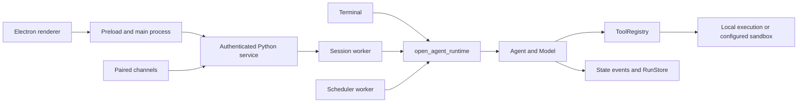

[English](architecture.md) · [简体中文](zh/architecture.md)

# Architecture

VERA assembles one Python Runtime for terminal, desktop, channels and scheduled tasks. Entry adapters own transport and lifecycle; the Agent owns the query/action loop.

## Execution path

## Module ownership

| Module | Responsibility |
| --- | --- |
| `runtime.py` | Assemble models, environments, capability selection and resource cleanup. |
| `agents/`, `models/` | Query, parse, execute, observe and finish; track limits and usage. |
| `tools/`, `plugins/`, `markets/` | Register capabilities; validate declarations and explicit activation. |
| `memory/`, `user_context.py` | Project/shared memory, bounded context, explicit global rules and notes. |
| `environments/`, `permissions.py`, `modes/` | Execution backend, approval, read-only planning and budgeted goals. |
| `storage.py` | Immutable tool receipts, checkpoints, cancellation and reconciled continuation. |
| `desktop/` | HTTP requests, session workers, streaming, private settings, media and integrations. |
| `channels/`, `scheduler/`, `evolution/` | Remote transport, persistent jobs and separate source experiments. |
| `desktop/src/` | Electron main/preload, typed contracts and React presentation. |

## State and failure boundaries

Each desktop session has independent model history and a worker process. SQLite holds the session catalog; exported display snapshots are secondary. Runtime receipts remain separate from editable display history. Recalling a message does not undo filesystem effects.

Streaming events carry session IDs and sequence numbers. Reconnection reloads a baseline when the cursor cannot be continued. Mutating requests are not replayed automatically. Abort terminates the owned worker tree and clears pending approvals.

A tool reply records the returned status; an unknown reply does not establish success. Resume requires matching execution identity and explicit reconciliation of unresolved effects. See [storage](storage.md).

## Authority

Local execution uses the owner's OS permissions. Confirmation and sandbox isolation are separate choices. Plan mode selects confined readers and its plan writer. Goal mode retains the selected permissions and budgets. Plugin installation and activation are separate operations.

The local desktop API grants owner authority after authentication. LAN and messaging use separate opt-in, pairing and method restrictions. See [API boundaries](desktop-api.md), [security](SECURITY.md) and [frontend integration](frontend-integration.md).

The optional taskboard runs as a separate loopback service. It requires a separately installed upstream application; see [taskboard](taskboard.md).
