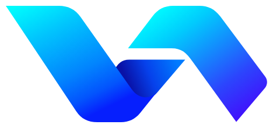
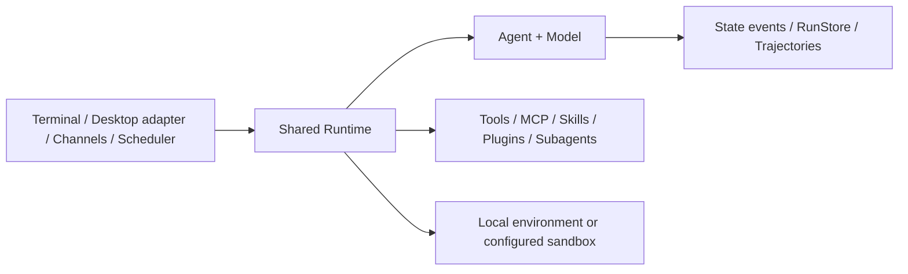

[English](index.md) · [简体中文](zh/index.md)

<h1>VERA</h1>

A modular agent harness for the terminal and desktop integrations.

!!! abstract "Start with the workflow you need"

    Run an interactive task, select project files and capabilities, or call the same Runtime from your application. VERA combines model adapters, tools, memory, delegation, storage and bounded execution around a small Agent Loop.

| Workflow | Guide |
| --- | --- |
| Install and start | [Quick start](quickstart.md), [Windows and Bash](windows.md) |
| Chat with project context | [Terminal commands](terminal.md), [Plans and goals](markets-and-modes.md) |
| Add capabilities | [Web](web-tools.md), [MCP](mcp.md), [Skills](skills.md), [Plugins](plugins.md) |
| Delegate and remember | [Subagents](subagents.md), [Hindsight](hindsight-memory.md) |
| Choose execution boundaries | [Permissions and sandboxes](sandbox.md) |
| Inspect and recover | [State events](agent-state.md), [Run storage](storage.md) |
| Work beyond the terminal | [Channels](channels.md), [Scheduler](scheduler.md), [Frontend integration](frontend-integration.md) |
| Evaluate source changes | [Versioned evolution](evolution.md) |

## A shared runtime

The terminal remains available. The Electron desktop uses the Python desktop service over an authenticated loopback HTTP transport. Channels and scheduled tasks reuse the same Runtime through their adapters. State observation, planning, standing goals and scheduling remain extensions around the existing Agent Loop.

!!! note "Naming and compatibility"

    The product is VERA and the distribution is `vera-harness`. Current Python imports use `vera.*`, configuration uses `vera.yaml` and `VERA_*`, and new trajectories use VERA identifiers. Legacy CLI, environment and built-in config aliases remain available; update old Python import paths. See [migration](advanced/v2_migration.md).

## Development and maintenance

[Architecture](architecture.md) · [API boundaries](desktop-api.md) · [Taskboard](taskboard.md) · [Testing and delivery](testing.md) · [Repository structure](repository-structure.md) · [Licenses and fonts](licenses.md)
