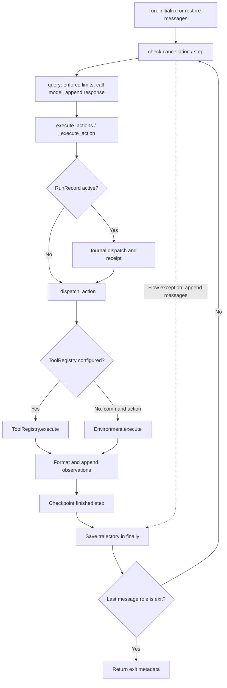

[English](../../advanced/control_flow.md) · [简体中文](control_flow.md)

# Agent 控制流

!!! abstract "读取现有循环，再选择扩展点"

    run 初始化消息或恢复检查点，循环调用 step，处理流程控制异常并保存轨迹。step 先 query 后执行动作；query 检查步骤/费用/时间，模型返回后把计数和消息更新；动作结果经模型适配器格式化后追加。

## 执行与停止

注册表存在时通过统一工具路由，传统动作经 Environment 执行。Submitted 结束任务；LimitsExceeded/TimeExceeded/连续格式失败按已有规则返回退出状态；未知异常记录并传播。工具返回值、成功状态和外部副作用是否可确定必须区分。每步 finally 可保存轨迹，存储在完整边界检查点。

DefaultAgent 协调流程，Model 解析 provider 动作与观察格式，Environment 执行命令。InteractiveAgent 加审批与用户输入；Stateful 仅观察事件。Runtime 组装能力，goal 在轮次边界调用普通 run，scheduler 在独立进程运行任务；不把这些特性塞进基础循环。图与当前源码引用保留在下方。

## 配置、命令与源码示例



```python
--8<-- "src/vera/agents/default.py"
```

```python
def step(self) -> list[dict]:
    return self.execute_actions(self.query())
```

```python
def query(self) -> dict:
    # ... limit checks ...
    message = self.model.query(self.messages)
    self.add_messages(message)
    return message
```

```python
def execute_actions(self, message: dict) -> list[dict]:
    outputs = [self._execute_action(action) for action in message.get("extra", {}).get("actions", [])]
    return self.add_messages(*self.model.format_observation_messages(...))
```

```python
# In Environment.execute
def _check_finished(self, output: dict):
    lines = output.get("output", "").lstrip().splitlines(keepends=True)
    if lines and lines[0].strip() == "COMPLETE_TASK_AND_SUBMIT_FINAL_OUTPUT":
        raise Submitted({"role": "exit", "content": ..., "extra": {...}})
```

```python
while True:
    try:
        self.step()
    except InterruptAgentFlow as e:
        self.add_messages(*e.messages)
    if self.messages[-1].get("role") == "exit":
        break
```
