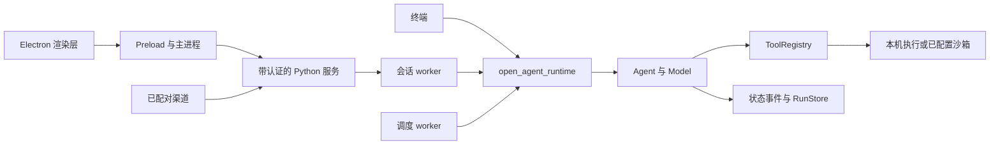

[English](../architecture.md) · [简体中文](architecture.md)

# 系统架构

VERA 为终端、桌面、远程渠道和定时任务组装同一套 Python Runtime。入口适配器负责传输和生命周期，Agent 负责模型请求与工具执行循环。

## 执行链路

## 模块职责

| 模块 | 职责 |
| --- | --- |
| `runtime.py` | 组装模型、环境和所选能力，统一释放运行资源。 |
| `agents/`、`models/` | 请求、解析、执行、观察与结束；记录限制和用量。 |
| `tools/`、`plugins/`、`markets/` | 注册能力、校验声明，区分安装和显式启用。 |
| `memory/`、`user_context.py` | 项目与共享记忆、有界上下文、显式全局规则和笔记。 |
| `environments/`、`permissions.py`、`modes/` | 执行后端、审批、只读规划和有预算的目标。 |
| `storage.py` | 工具收据、检查点、取消及核对后的继续执行。 |
| `desktop/` | HTTP、会话进程、流式事件、私有配置、媒体与应用集成。 |
| `channels/`、`scheduler/`、`evolution/` | 远程传输、持久任务和独立源码演化实验。 |
| `desktop/src/` | Electron 主进程、preload、类型契约与 React 界面。 |

## 状态与失败边界

每个桌面对话有独立模型历史和 worker。SQLite 是会话目录的权威来源，导出的展示快照是副本。运行收据独立于可编辑的展示历史；撤回消息不撤销文件修改。

流式事件携带会话标识和序号。游标无法继续时重新加载基线，有副作用的请求不会自动重放。停止操作终止所属进程树并清除待审批请求。

工具返回状态不等于业务成功。结果不明时保留未知状态；恢复要求运行身份匹配，并显式核对未确定的副作用。见[运行存储](storage.md)。

## 权限边界

本机执行具有当前用户的系统权限。操作确认和沙箱隔离是两个选择。Plan 模式只提供受限读取及方案写入；Goal 沿用所选权限和预算。插件安装后需另行启用。

桌面本机 API 在认证后提供所有者权限。LAN 与消息渠道另有启用、配对和方法限制。见[接口边界](desktop-api.md)、[安全说明](SECURITY.md)及[前端对接](frontend-integration.md)。

可选任务看板是另一个回环服务，需要单独安装上游应用，见[任务看板](taskboard.md)。
