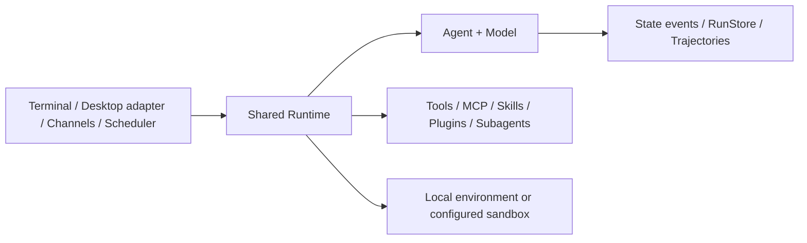

[English](../index.md) · [简体中文](index.md)

# VERA

面向终端与桌面端集成的模块化 Agent Harness。

!!! abstract "从你的任务开始"

    在终端运行任务，添加项目文件，选择工具与执行环境；也可以在应用中调用同一套 Runtime。模型、工具、记忆、委派和存储围绕现有 Agent Loop 组装，运行模式与权限、沙箱分别管理。

| 使用场景 | 文档 |
| --- | --- |
| 安装与启动 | [快速开始](quickstart.md)、[Windows 与 Bash](windows.md) |
| 项目对话 | [终端命令](terminal.md)、[规划与目标](markets-and-modes.md) |
| 扩展能力 | [网页工具](web-tools.md)、[MCP](mcp.md)、[Skill](skills.md)、[插件](plugins.md) |
| 委派和记忆 | [Subagent](subagents.md)、[Hindsight](hindsight-memory.md) |
| 执行边界 | [沙箱](sandbox.md)、[状态](agent-state.md)、[存储](storage.md) |
| 后台与应用 | [渠道](channels.md)、[定时任务](scheduler.md)、[前端对接](frontend-integration.md) |
| 评测和演化 | [版本化演化](evolution.md) |

终端入口继续可用。Electron 桌面端通过带认证的本机回环 HTTP 服务复用 Python Runtime；渠道和定时任务也通过适配器复用同一 Runtime。`vera-harness` 是当前包名；`vera`、旧命令和数据标识保留兼容。可选服务测试、真实模型验证与任务评测分别记录，不将其他项目的公开分数当作 VERA 成绩。

## 配置、命令与源码示例

示例与英文版保持同一调用契约；按环境替换占位参数，标识符保留源码命名。

## 开发与维护

[系统架构](architecture.md) · [接口边界](desktop-api.md) · [任务看板](taskboard.md) · [测试与交付](testing.md) · [仓库结构](repository-structure.md) · [许可证与字体](licenses.md)
